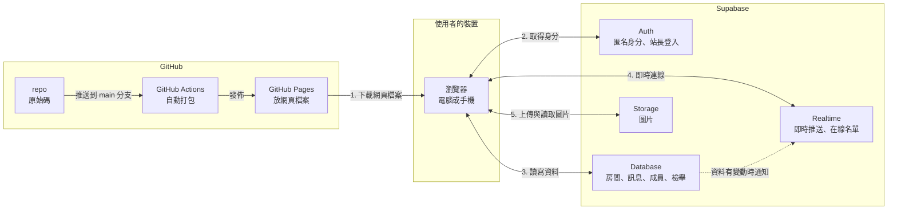
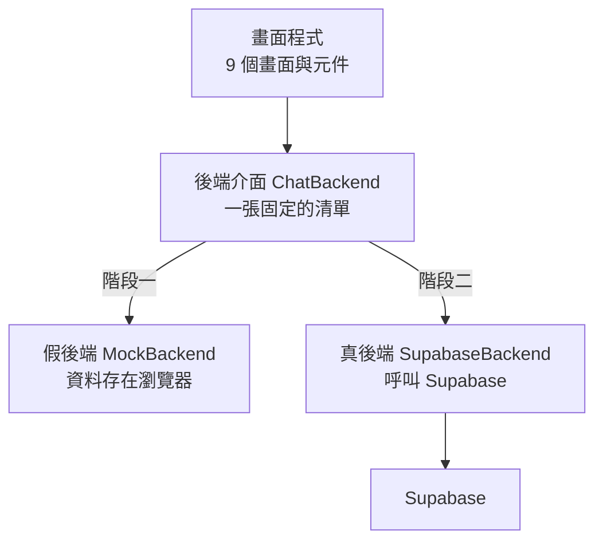
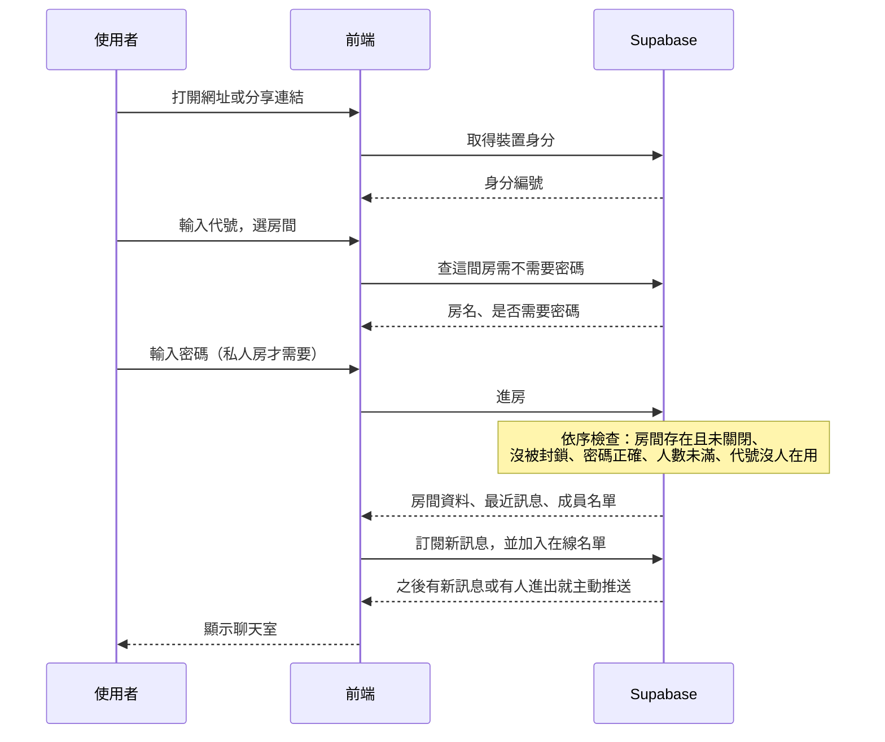
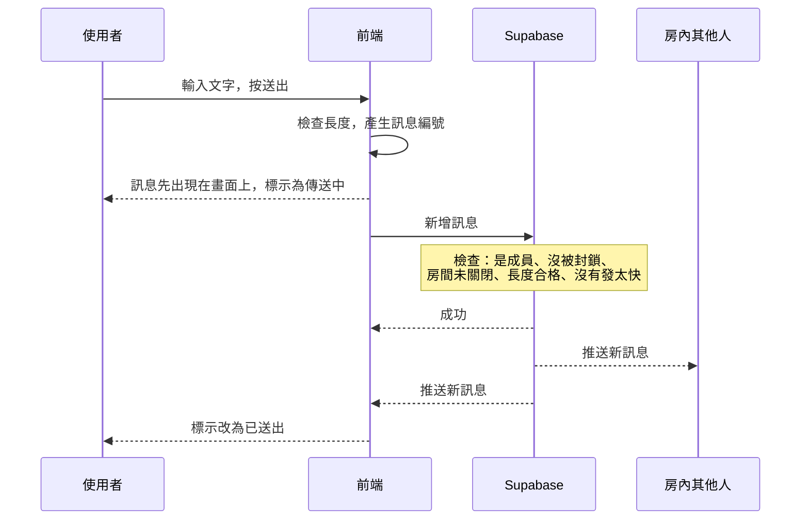

# 匿名聊天室：架構文件

- 文件日期：2026-10-13
- 對應需求：[requirements.md](./requirements.md)，加上需求訪談的 16 題結論
- 文件用途：寫程式之前先把「要做什麼、怎麼分工、怎麼驗收」講清楚。本文件不規定顏色與樣式，那是設計階段的工作。

---

## 1. 專案說明與目標

### 1.1 這是什麼

一個不用註冊、不用登入的網頁聊天室。打開網址、輸入一個代號，就能進房間看別人的訊息、自己發訊息。電腦和手機的瀏覽器都能用，不需要安裝 App。

### 1.2 使用者能做的事（訪談結論）

| 主題 | 結論 |
|---|---|
| 代號 | 進站輸入代號。同一間房內不能和「目前在房內的人」重複，撞名要換一個。裝置會記住上次的代號。 |
| 房間 | 任何人都能開房。公開房出現在列表上；私人房不上列表，要設密碼。 |
| 進私人房 | 用連結或 6 碼短房號，兩種都要輸入密碼。 |
| 訊息 | 文字和圖片。可以刪除自己的訊息。 |
| 歷史訊息 | 只顯示最近 7 天。更早的不顯示，但資料仍保留，畫面上不承諾「訊息會消失」。 |
| 在線狀態 | 看得到目前在房內的代號名單，有人進出時聊天區有提示。 |
| 房主 | 可以刪別人的訊息、踢人、關閉房間。開房時拿到一組管理碼，可在別的裝置拿回房主身分。 |
| 踢人 | 被踢的裝置不能再進這間房，其他房間不受影響。 |
| 房間壽命 | 連續 7 天沒有新訊息就自動關閉。 |
| 通知 | 切到別的分頁時，分頁標題顯示未讀數並有提示音。網頁關掉就不通知。 |
| 站長 | 有管理頁，可看所有房間（含私人房）、刪任何訊息、關任何房間。使用者可以檢舉訊息。 |

### 1.3 目標

1. 第一次來的人，30 秒內能從打開網址走到發出第一則訊息。
2. 手機和電腦用同一套網頁，不另外做 App。
3. 營運成本為零：只用 GitHub Pages 和 Supabase 的免費方案。
4. 私人房的內容，沒有密碼的人即使懂技術也拿不到。
5. 分兩階段完成，第一階段的畫面程式在第二階段不用重寫。

### 1.4 先講清楚的限制

因為不用登入，系統只能認「裝置」（更精確地說，是某一個瀏覽器），認不出「人」。所以：

- 「自己的訊息」「房主身分」「被踢」都綁在瀏覽器上。換瀏覽器、開無痕視窗或清除瀏覽器資料，就會被當成另一個人。
- 踢人只能擋住大部分的人，擋不住刻意換裝置回來的人。
- 匿名只是「其他使用者不知道你是誰」。站長看得到所有訊息內容，Supabase 也會有連線紀錄。這不是保證無法追查的匿名工具。

---

## 2. 整體架構圖



怎麼讀這張圖：

- **GitHub Pages 只負責「發網頁檔案」**。它是 GitHub 提供的免費靜態網站空間，「靜態」的意思是它只會把檔案原封不動交給瀏覽器，自己不會執行任何程式、也不會存資料。聊天內容完全不會經過 GitHub。
- **瀏覽器下載完網頁之後，直接和 Supabase 對話**。Supabase 是一個雲端後端服務，把資料庫、身分驗證、即時連線、檔案儲存包成一套，讓我們不用自己架伺服器。
- **我們沒有自己的伺服器**。所有「誰可以做什麼」的規則，都寫在 Supabase 的資料庫裡，由資料庫執行。這一點決定了後面第 8、9 節的安全設計。
- 階段一還沒接 Supabase，圖上右邊整塊不存在，由瀏覽器裡的一份「假後端」暫時代替（見第 4 節）。

---

## 3. 技術選擇

### 3.1 前端

「前端」是指在使用者瀏覽器裡執行的那部分程式，也就是使用者看得到、點得到的東西。

| 項目 | 選了什麼 | 為什麼 |
|---|---|---|
| 語言 | **TypeScript**：JavaScript（瀏覽器唯一看得懂的程式語言）加上「型別檢查」的版本，會在程式執行前先檢查資料格式有沒有對上。 | 這個專案最容易出錯的地方是「前端以為的資料格式」和「後端實際給的格式」不一致。TypeScript 能在打包時就抓出來，而不是等使用者遇到。 |
| 框架 | **React**：一套用來組合畫面的工具，把畫面拆成一塊塊可重複使用的「元件」。 | 這個專案有 9 個畫面，而且聊天室畫面會一直隨著新訊息、進出名單改變。React 負責「資料一變，畫面自動跟著變」，不用手動改畫面。它也是資源最多、最容易找到人或 AI 協助維護的選擇。 |
| 打包工具 | **Vite**：把我們寫的許多程式檔整理、壓縮成瀏覽器能直接用的少數幾個檔案。 | 產出的就是純靜態檔案，正好符合 GitHub Pages 的要求。設定少、速度快。 |
| 換頁方式 | **React Router 的 hash 模式**：網址會長成 `…/#/r/K7M2Q9`，`#` 後面的部分由前端自己解讀。 | GitHub Pages 不認得 `/r/K7M2Q9` 這種路徑，重新整理會出現 404。把路徑放在 `#` 後面可以完全避開這個問題，分享連結也能正常運作。 |
| 樣式 | **一般的 CSS 檔案加上 CSS 變數**，不使用現成的 UI 元件庫。 | 樣式是設計階段的工作。不綁元件庫，設計階段才有完整的自由度。 |
| 圖片處理 | **瀏覽器內建的 Canvas 功能**，上傳前先在使用者裝置上縮圖並轉成 JPEG。 | 省流量、省儲存空間；重新繪製也會順便去掉照片裡藏的拍攝地點等資訊，這對匿名聊天室很重要。 |
| 測試 | **Vitest**：自動執行檢查程式的工具。 | 和 Vite 是同一家，不用額外設定。主要用來測「輸入檢查規則」和「假後端」。 |

### 3.2 Supabase 用到的功能

| 功能 | 用來做什麼 | 為什麼 |
|---|---|---|
| **Auth 的匿名登入**（Anonymous Sign-in）：使用者什麼都不用做，Supabase 就自動發給這個瀏覽器一個隨機的身分編號。 | 讓系統認得「同一個瀏覽器」。「自己的訊息」「房主」「被踢」都靠這個編號。 | 使用者完全沒感覺到登入，符合「不用登入」的需求；但資料庫因此有一個**無法由前端偽造**的身分可以拿來判斷權限。如果改成前端自己產生一個編號，任何人都能冒充別人。 |
| **Auth 的電子郵件加密碼登入** | 只給站長一個人用，進入管理頁。 | 站長權限需要真正的登入才安全。訪談中說的「站長密碼」就是這個帳號的密碼。 |
| **Database**（PostgreSQL 資料庫） | 儲存房間、訊息、成員、封鎖、檢舉。 | 資料需要保留（超過 7 天也留著），而且需要依條件查詢。 |
| **Row Level Security，簡稱 RLS**：寫在資料庫裡的規則，逐筆決定「這個身分能不能讀或寫這一筆資料」。 | 私人房的訊息只有通過密碼的人讀得到；只能刪自己的訊息；只有站長能看全部。 | 我們沒有自己的伺服器，前端又是公開的，任何人都能繞過畫面直接對資料庫發請求。RLS 是唯一真正擋得住的地方。 |
| **Database Functions**（資料庫函式，前端透過 RPC 呼叫）：存在資料庫裡的小段程式，前端只能呼叫，看不到也改不了內容。 | 進房（檢查密碼、封鎖、撞名）、開房、踢人、關房、刪訊息、取回房主身分。 | 這些動作需要「先檢查好幾件事，再一次改好幾筆資料」，而且密碼比對一定要在前端碰不到的地方做。 |
| **Realtime 的 Postgres Changes**：資料庫有新資料或資料被改時，自動推送給正在聽的瀏覽器。 | 新訊息、訊息被刪、房間被關、自己被踢。 | 推送前會逐筆套用 RLS，所以被踢的人會立刻收不到新訊息，不需要靠前端自律。 |
| **Realtime 的 Presence**：追蹤「現在有哪些人連著這個頻道」，有人斷線會自動移除。 | 在線名單、進出提示。 | 關掉分頁或手機斷網時，不需要使用者做任何事，名單就會自動更新。 |
| **Storage**（檔案儲存） | 存聊天圖片，放在不公開的儲存區。 | 私人房的圖片也必須受密碼保護，所以不能用公開網址；讀取時由 Supabase 發一個短時間有效的網址。 |
| **pg_cron**（資料庫內建的排程） | 每小時檢查一次，把 7 天沒新訊息的房間關閉。 | 不需要另外找地方跑排程。 |

**刻意不用的功能：Edge Functions**（Supabase 上的小型伺服器程式）。用了就必須處理後面第 8 節說的「絕對不能公開的金鑰」，目前的需求用 RLS 加資料庫函式就能完成，先不增加這層複雜度。

### 3.3 資料庫裡會有哪些表

| 表 | 存什麼 | 誰讀得到 |
|---|---|---|
| `rooms` | 房間名稱、房號、公開或私人、房主、建立時間、最後訊息時間、關閉時間 | 公開房所有人；私人房只有成員；站長全部 |
| `room_secrets` | 房間密碼和管理碼（都是雜湊值，也就是打亂後無法還原的版本） | 沒有人讀得到，只有資料庫函式能比對 |
| `room_members` | 誰通過檢查進了哪間房、用什麼代號、最後一次回報在線的時間 | 同一間房的成員、站長 |
| `room_bans` | 哪個裝置被哪間房封鎖 | 被封鎖的本人、該房房主、站長 |
| `messages` | 訊息內容、圖片位置、發送者、時間、是否已刪除 | 該房成員且限最近 7 天；站長全部 |
| `deleted_messages` | 被刪訊息的原始內容 | 只有站長（用來處理檢舉與濫用） |
| `reports` | 檢舉紀錄：哪則訊息、誰檢舉、理由、處理狀態 | 只有站長 |
| `join_attempts` | 密碼輸入錯誤的紀錄，用來防猜密碼 | 沒有人讀得到 |
| `admins` | 站長的身分編號（只有一筆） | 沒有人讀得到，只有權限規則會查它 |

---

## 4. 兩個階段

### 4.1 階段一：還沒接 Supabase

**目標**：所有畫面和操作流程都做完，可以在 GitHub Pages 的正式網址上實際點來點去。

做法是在瀏覽器裡放一份「假後端」（Mock）：一段模擬後端行為的程式，資料只存在使用者自己的瀏覽器裡。

階段一要能做到：

- 第 7 節列的 9 個畫面全部可操作，包含建立房間、私人房密碼、撞名提示、刪訊息、踢人、關房、檢舉、站長管理頁。
- **在同一台電腦的同一個瀏覽器開兩個分頁，就能模擬兩個人聊天**。這靠的是瀏覽器內建的 BroadcastChannel 功能，讓同一個瀏覽器的分頁之間可以互相傳話。每個分頁會被當成不同的裝置，所以可以一邊當房主、一邊當訪客，測試踢人和撞名。
- 內建幾間示範房間和一些示範訊息，第一次打開不會是空的。
- 畫面上固定顯示「示範模式：資料只存在這台瀏覽器，別人看不到」，避免有人誤以為已經可以真的聊天。
- 網址加上 `?debug=1` 會出現一個測試面板，可以按鈕模擬「斷線」「恢復連線」「送出失敗」，用來檢查這些情況下的畫面。
- 示範模式的站長密碼固定寫在畫面上（例如 `demo`），因為這時沒有真的資料需要保護。

階段一做不到、也不打算做到的事：不同裝置之間無法互通；清除瀏覽器資料後全部歸零；沒有任何真正的安全性。

**怎麼在 GitHub Pages 上看到效果**：階段一就把第 12 節的自動部署設定好，之後每次把程式推送到 GitHub，網站幾分鐘內就會更新。

### 4.2 階段二：接上 Supabase

| 項目 | 階段一 | 階段二 |
|---|---|---|
| 資料存在哪 | 使用者自己的瀏覽器 | Supabase 資料庫 |
| 誰看得到訊息 | 只有同一個瀏覽器的其他分頁 | 所有進同一間房的人，不分裝置 |
| 裝置身分 | 每個分頁隨機產生 | Supabase 匿名登入發的身分編號 |
| 密碼與權限檢查 | 假後端裝個樣子 | 資料庫真的檢查，繞過畫面也沒用 |
| 圖片 | 存在瀏覽器裡 | 上傳到 Supabase Storage |
| 在線名單 | 分頁之間互相通知 | Supabase Presence |
| 站長登入 | 畫面上寫的示範密碼 | 真的帳號密碼 |
| 「示範模式」標示 | 顯示 | 不顯示 |

階段二新增的工作只有三塊：寫 Supabase 那一側的資料表與規則（SQL 檔）、寫一份「真後端」程式去呼叫 Supabase、設定金鑰與部署變數。**畫面程式不動。**

### 4.3 前端怎麼設計才不用重寫

核心規則只有一條：

> **畫面程式不准直接碰 Supabase，也不准直接碰假資料。畫面只能透過一份固定的「後端介面」做事。**

「介面」在這裡的意思是一張清單，列出後端能做的所有事（進房、送訊息、踢人……）以及每件事要給什麼、會拿回什麼。第 5 節的通訊約定就是這張清單的內容。



具體做法：

1. **同一張清單，兩份實作**。`MockBackend` 和 `SupabaseBackend` 都照同一份 `ChatBackend` 清單寫，TypeScript 會檢查兩邊有沒有漏做或格式不符。
2. **用一個設定值切換**。設定 `VITE_BACKEND=mock` 用假後端，`VITE_BACKEND=supabase` 用真後端。畫面程式不知道也不需要知道現在用的是哪一份。
3. **資料格式只定義一次**。訊息、房間、成員長什麼樣子，寫在同一個檔案裡，畫面和兩份後端共用。
4. **輸入檢查規則只寫一次**。代號長度、訊息長度這些規則放在共用檔案，畫面上先擋一次；階段二資料庫會再擋一次。
5. **錯誤用固定代碼**。兩份後端遇到同樣的狀況都回同樣的代碼（例如 `NICKNAME_TAKEN`），畫面只看代碼決定顯示什麼。
6. **假後端要故意做得像真的**。每個動作延遲 0.2 到 0.5 秒才回應，也會回各種錯誤。這樣階段一就會把「等待中」「失敗重試」的畫面做好，不會到階段二才發現漏了。
7. **階段二完成後假後端不刪**。它繼續用來開發畫面和跑自動測試，不用連網、不會弄髒正式資料。

---

## 5. 通訊約定

這一節是畫面和後端之間的合約。名稱一律用英文是因為程式碼裡要用；右邊都有中文說明。

### 5.1 資料格式

時間一律用 ISO 8601 格式的世界標準時間字串，例如 `2026-10-13T08:30:00.000Z`，顯示時再換成使用者當地時間。編號一律是 UUID（一種幾乎不可能重複的隨機長編號）。

**Message（訊息）**

```json
{
  "id": "0b8f6c1e-5a55-4d0e-9a53-2f1c7d0e9a11",
  "roomId": "7c1d…",
  "senderId": "e2a4…",
  "nickname": "小明",
  "body": "大家好",
  "image": null,
  "createdAt": "2026-10-13T08:30:00.000Z",
  "deletedAt": null,
  "deletedBy": null
}
```

| 欄位 | 說明 |
|---|---|
| `id` | 訊息編號。**由前端在送出前自己產生**，這樣網路不穩重送時，後端看到同一個編號就知道是同一則，不會出現兩次。 |
| `senderId` | 發送者的裝置身分編號。由後端填入，前端送什麼都會被忽略。 |
| `nickname` | 發送當下的代號。由後端依成員資料填入，前端無法冒用別人的代號。 |
| `body` | 文字內容，最多 500 字。只有圖片時是空字串。 |
| `image` | 沒有圖片時是 `null`；有圖片時是 `{ "path": "…", "width": 1200, "height": 900 }`。`path` 是圖片在儲存區的位置，不是網址。 |
| `deletedAt` | 被刪除的時間；沒被刪是 `null`。被刪除的訊息 `body` 會是空字串、`image` 會是 `null`。 |
| `deletedBy` | `"sender"`（本人）、`"owner"`（房主）、`"admin"`（站長）或 `null`。 |

`body` 和 `image` 至少要有一個有內容。

**Room（房間）**

```json
{
  "id": "7c1d…",
  "code": "K7M2Q9",
  "name": "深夜閒聊",
  "isPublic": true,
  "onlineCount": 5,
  "lastMessageAt": "2026-10-13T08:30:00.000Z",
  "createdAt": "2026-10-10T02:00:00.000Z",
  "closedAt": null
}
```

`code` 是 6 碼房號，只用大寫英文和數字，並排除容易看錯的 `0`、`O`、`1`、`I`、`L`。公開房和私人房都有房號，分享連結就是 `…/#/r/K7M2Q9`。

**Member（成員）**

```json
{ "userId": "e2a4…", "nickname": "小明", "isOwner": false, "joinedAt": "2026-10-13T08:29:00.000Z" }
```

**Report（檢舉，只有站長看得到）**

```json
{
  "id": "…", "messageId": "…", "roomId": "…", "reason": "不當圖片",
  "createdAt": "2026-10-13T08:31:00.000Z", "resolvedAt": null
}
```

### 5.2 指令（畫面請後端做的事）

| 指令名稱 | 做什麼 | 要給什麼 | 成功拿回什麼 |
|---|---|---|---|
| `session.start` | 取得這個裝置的身分 | 無 | `{ userId }` |
| `rooms.listPublic` | 取得公開房間列表 | 無 | `Room[]` |
| `rooms.lookup` | 用房號查房間 | `{ code }` | `{ name, isPublic, needsPassword }` |
| `rooms.create` | 開房 | `{ name, isPublic, password? }` | `{ room, ownerCode }`，`ownerCode` 是管理碼，只回這一次 |
| `rooms.join` | 進房 | `{ code, nickname, password? }` | `{ room, isOwner, members, messages }` |
| `rooms.heartbeat` | 每 25 秒回報「我還在」 | `{ roomId }` | 無 |
| `rooms.leave` | 離開房間 | `{ roomId }` | 無 |
| `rooms.claimOwner` | 用管理碼取回房主身分 | `{ roomId, ownerCode }` | 無 |
| `rooms.kick` | 踢人（房主） | `{ roomId, userId }` | 無 |
| `rooms.close` | 關閉房間（房主或站長） | `{ roomId }` | 無 |
| `messages.loadOlder` | 往上捲時載入更早的訊息 | `{ roomId, before }` | `Message[]`，一次最多 50 則 |
| `messages.send` | 送出訊息 | `{ id, roomId, body, image? }` | `Message` |
| `messages.delete` | 刪除訊息 | `{ messageId }` | 無 |
| `messages.report` | 檢舉訊息 | `{ messageId, reason }` | 無 |
| `images.upload` | 上傳圖片 | `{ roomId, file }` | `{ path, width, height }` |
| `images.getUrl` | 取得圖片的暫時網址 | `{ path }` | `{ url }`，一小時內有效 |
| `admin.signIn` / `admin.signOut` | 站長登入、登出 | `{ email, password }` | 無 |
| `admin.listRooms` | 所有房間（含私人、含已關閉） | 無 | `Room[]` |
| `admin.listReports` | 檢舉清單 | `{ onlyOpen }` | 檢舉與對應的訊息內容 |
| `admin.getMessages` | 看某間房的訊息（不受 7 天限制，含被刪訊息的原文） | `{ roomId, before? }` | `Message[]` |
| `admin.resolveReport` | 把檢舉標為已處理 | `{ reportId }` | 無 |

### 5.3 事件（後端主動通知畫面的事）

| 事件名稱 | 什麼時候發生 | 附帶資料 |
|---|---|---|
| `message.created` | 房間裡有新訊息（包含自己發的） | `Message` |
| `message.deleted` | 有訊息被刪 | `{ id, deletedAt, deletedBy }` |
| `presence.changed` | 在線名單有變動 | `{ members: Member[] }`，每次都給完整名單 |
| `member.joined` | 有人進房 | `{ userId, nickname, at }` |
| `member.left` | 有人離開 | `{ userId, nickname, at }` |
| `room.closed` | 這間房被關了 | `{ roomId, closedBy }`，`closedBy` 是 `"owner"`、`"admin"` 或 `"inactive"` |
| `self.kicked` | 自己被踢了 | `{ roomId }` |
| `connection.changed` | 連線狀態改變 | `{ status }`，值是 `"connected"`、`"reconnecting"` 或 `"offline"` |

進出提示（`member.joined`、`member.left`）只是當下顯示，不會存進資料庫，重新進房後不會看到之前的進出紀錄。

### 5.4 錯誤代碼

| 代碼 | 意思 | 畫面上的反應 |
|---|---|---|
| `ROOM_NOT_FOUND` | 房號不存在 | 顯示「找不到這間房間」 |
| `ROOM_CLOSED` | 房間已關閉 | 顯示「這間房間已經關閉」 |
| `ROOM_FULL` | 房間人數已滿 | 顯示「房間人數已滿，請稍後再試」 |
| `WRONG_PASSWORD` | 密碼錯誤 | 密碼欄位下方顯示錯誤 |
| `TOO_MANY_ATTEMPTS` | 密碼錯太多次 | 顯示還要等多久才能再試 |
| `NICKNAME_TAKEN` | 代號有人在用 | 請使用者換一個代號 |
| `BANNED` | 這台裝置被這間房封鎖 | 顯示「你已被請出此房間」 |
| `NOT_MEMBER` | 還沒進房就想操作 | 回到進房流程 |
| `NOT_ALLOWED` | 沒有權限 | 顯示「你沒有權限這麼做」 |
| `INVALID_INPUT` | 輸入不合規定 | 在對應欄位顯示原因 |
| `RATE_LIMITED` | 操作太頻繁 | 顯示「請稍等一下再試」 |
| `UPLOAD_FAILED` | 圖片上傳失敗 | 顯示失敗並提供重試 |
| `NETWORK_ERROR` | 網路有問題 | 顯示連線狀態，提供重試 |

### 5.5 階段二：每件事實際對應到 Supabase 的哪個功能

| 約定中的項目 | Supabase 的做法 |
|---|---|
| `session.start` | 匿名登入。身分存在瀏覽器裡，下次來自動沿用。 |
| `rooms.create`、`rooms.join`、`rooms.heartbeat`、`rooms.leave`、`rooms.claimOwner`、`rooms.kick`、`rooms.close`、`messages.delete` | 各自對應一個資料庫函式 |
| `rooms.listPublic`、`rooms.lookup` | 資料庫函式，只回傳可以公開的欄位 |
| `messages.send`、`messages.report` | 直接新增一筆資料，由 RLS 和資料庫觸發程序檢查 |
| `messages.loadOlder` | 直接查詢，RLS 自動只給最近 7 天、且是成員才給 |
| `images.upload`、`images.getUrl` | Storage 上傳、產生短效網址 |
| `message.created` | Postgres Changes：`messages` 表有新增 |
| `message.deleted` | Postgres Changes：`messages` 表有更新 |
| `room.closed` | Postgres Changes：`rooms` 表該房間有更新 |
| `self.kicked` | Postgres Changes：`room_bans` 表出現自己的紀錄 |
| `presence.changed`、`member.joined`、`member.left` | Presence，頻道名稱是 `room:` 加房間編號，設為私人頻道，只有成員連得上 |
| `connection.changed` | Realtime 連線狀態 |

Presence 每個人回報的內容是 `{ userId, nickname, joinedAt }`。這份內容是由各自的瀏覽器回報的，所以畫面顯示代號時會以資料庫裡的成員資料為準，不直接相信回報的代號。

---

## 6. 資料流

以下都以階段二為準。階段一的流程相同，只是「Supabase」換成瀏覽器裡的假後端。

### 6.1 進入聊天室



補充：

1. 第一次來會做匿名登入；之後來會沿用瀏覽器裡存的身分。
2. 代號存在瀏覽器裡，下次自動帶入，可以改。
3. 進房的五項檢查全部在資料庫函式裡做，任何一項不過都回對應的錯誤代碼，前端不會拿到任何訊息。
4. 同一台裝置曾經用密碼進過某間私人房，之後再進不用重新輸入密碼（除非被踢）。
5. 一開始只載入最近 50 則；往上捲再載入更早的，最多到 7 天前。
6. 進房成功後，前端每 25 秒回報一次「我還在」。超過 60 秒沒回報的人，他的代號就可以被別人使用。
7. 如果這台裝置是這間房的房主，進房時就會帶回 `isOwner: true`，畫面顯示房主工具。

### 6.2 送出訊息



補充：

1. **先顯示再送出**。使用者按下送出就立刻看到自己的訊息，不用等網路。
2. 因為訊息編號是前端產生的，後端推送回來的那一則和畫面上那一則編號相同，前端會把兩者當成同一則，不會出現兩次。
3. 送出失敗時，那一則訊息會標示「傳送失敗」，並提供「重試」和「刪除」。重試用同一個編號。
4. **有圖片時**多兩步：先在裝置上縮圖並轉成 JPEG，上傳到 Storage 拿到位置，再把位置放進訊息送出。上傳期間顯示進度，可以取消。
5. 收到別人的訊息時，如果分頁不在最前面，分頁標題的未讀數加一並播放提示音。

### 6.3 離開

離開有三種情況，處理方式不同：

| 情況 | 發生什麼 |
|---|---|
| **按「離開房間」** | 前端通知後端離開、退出在線名單、停止接收訊息，回到大廳。其他人立刻看到「小明 離開了房間」，代號立刻可以被別人使用。 |
| **直接關掉分頁或瀏覽器** | 前端來不及通知。Supabase 發現連線斷了，會自動把這個人從在線名單移除，其他人在大約半分鐘內看到離開提示。代號在最後一次回報的 60 秒後釋出。 |
| **被踢或房間被關** | 前端收到 `self.kicked` 或 `room.closed`，立刻停止接收、清掉畫面上的訊息，顯示對應的說明畫面。就算前端被動過手腳不照做，資料庫也已經不會再給這個人任何訊息。 |

離開後，裝置的成員紀錄仍然保留，所以仍然可以刪除自己以前發的訊息，也不用再輸入一次私人房密碼。

### 6.4 斷線重連

手機切到別的 App、進電梯、電腦休眠，都會造成斷線。

1. 前端發現連線斷了，畫面上方顯示「連線中斷，正在重新連線…」。訊息輸入框仍然可以打字。
2. 斷線期間按送出的訊息，會留在畫面上標示「等待連線」，不會消失。
3. 連線工具會自動重試，間隔逐漸拉長。使用者回到分頁時也會立刻再試一次。
4. 連上之後依序做四件事：
   - 重新進房一次（確認沒被踢、房間沒被關、代號還是自己的）。
   - **補漏**：向後端要「我最後看到的那一則之後的所有訊息」，補進畫面。靠編號去除重複。
   - 重新加入在線名單。
   - 把「等待連線」的訊息依序送出。編號不變，所以就算其實上次已經送成功，也不會重複。
5. 畫面上方的提示消失。
6. 如果斷線超過 60 秒，而且這段期間有別人用了同一個代號，重新進房會得到 `NICKNAME_TAKEN`，這時請使用者換一個代號再回到房間。
7. 短暫斷線（10 秒內回來）不會對其他人顯示離開和進入的提示，避免訊號不穩的人洗版。

---

## 7. 畫面清單

只列元素與行為，不規定外觀。每個畫面在手機和電腦上都要能完整操作；手機上空間不夠的區塊（例如在線名單）改成可以叫出來的面板。

### 畫面 1：輸入代號

第一次來，或瀏覽器裡沒有記住代號時出現。

| 元素 | 行為 |
|---|---|
| 網站名稱與一句說明 | 讓人知道這是匿名聊天室、不用註冊。 |
| 代號輸入框 | 1 到 20 個字。自動去掉頭尾空白。有記住的代號會先填好。 |
| 「進入」按鈕 | 代號是空的時候不能按。按下後記住代號，前往大廳；如果是從分享連結來的，直接前往那間房的進房流程。 |
| 錯誤提示 | 代號不合規定時，在輸入框下方說明原因。 |

### 畫面 2：大廳

| 元素 | 行為 |
|---|---|
| 目前代號與「更改」 | 按「更改」回到畫面 1。 |
| 公開房間列表 | 每一列顯示房名、目前在線人數、最後有人講話是多久以前。排序是在線人數多的在前，人數相同時最近有人講話的在前。點一列就進那間房。 |
| 列表是空的時候 | 顯示「目前沒有公開房間」和建立房間的入口。 |
| 「重新整理」 | 重新抓列表。列表也會每 30 秒自動更新一次。 |
| 「輸入房號加入」欄位與按鈕 | 輸入 6 碼房號。自動轉大寫、忽略空白。找不到時顯示錯誤。 |
| 「建立房間」按鈕 | 開啟畫面 3。 |
| 載入中與載入失敗的狀態 | 失敗時顯示原因和「再試一次」。 |

### 畫面 3：建立房間

| 元素 | 行為 |
|---|---|
| 房間名稱輸入框 | 1 到 30 個字。可以和別的房間同名。 |
| 「公開／私人」選擇 | 預設公開。旁邊各有一句說明兩者差別。 |
| 密碼輸入框 | 只在選私人時出現。4 到 50 個字。有「顯示密碼」的切換。 |
| 「建立」按鈕 | 必填欄位沒填好不能按。按下後顯示處理中，成功就前往畫面 4。 |
| 「取消」 | 回大廳。 |

### 畫面 4：房間建立成功

| 元素 | 行為 |
|---|---|
| 分享連結與「複製」按鈕 | 複製後短暫顯示「已複製」。 |
| 房號與「複製」按鈕 | 6 碼。 |
| 管理碼與「複製」按鈕 | **只會顯示這一次。** 旁邊說明：換裝置或清除瀏覽器資料後，要靠這組碼才能拿回房主身分，遺失無法補發。 |
| 「我已經記下管理碼」勾選 | 勾了才能按「進入房間」。 |
| 「進入房間」按鈕 | 直接以房主身分進房，不用再輸入密碼。 |

### 畫面 5：進房確認

只有在需要使用者補資料時才出現；公開房且代號沒撞名時會直接跳過。

| 元素 | 行為 |
|---|---|
| 房間名稱 | 讓使用者確認進的是哪一間。 |
| 密碼輸入框 | 私人房才出現。錯誤時顯示提示；錯太多次時顯示要等多久。 |
| 代號輸入框 | 撞名時才出現，並說明「這個代號目前有人在用」。 |
| 「進入」按鈕 | 送出後顯示處理中。 |
| 「回大廳」 | 放棄進房。 |

### 畫面 6：聊天室

| 區塊 | 元素 | 行為 |
|---|---|---|
| 頂部 | 房間名稱、公開或私人的標示 | 純顯示。 |
| 頂部 | 在線人數 | 手機上點它可叫出在線名單。 |
| 頂部 | 「分享」 | 顯示並可複製連結和房號。不會顯示密碼。 |
| 頂部 | 「離開」 | 回大廳。 |
| 頂部 | 提示音開關 | 記住使用者的選擇。 |
| 頂部 | 連線狀態條 | 只在斷線或重連時出現。 |
| 訊息區 | 一則訊息 | 顯示代號、時間、文字、圖片。自己的訊息和別人的要能區分。網址自動變成可點的連結，在新分頁開啟。 |
| 訊息區 | 圖片 | 先顯示縮小版，點了放大看。載入失敗時顯示替代文字。 |
| 訊息區 | 已刪除的訊息 | 原位置顯示「此訊息已刪除」；被房主或站長刪的顯示「此訊息已被管理者移除」。 |
| 訊息區 | 進出提示 | 「小明 進入了房間」「小明 離開了房間」，樣式上和一般訊息區分。 |
| 訊息區 | 訊息的操作選單 | 自己的訊息：刪除。別人的訊息：檢舉。房主額外有：刪除這則訊息、把這個人請出房間。刪除和踢人都要再確認一次。 |
| 訊息區 | 傳送狀態 | 自己的訊息顯示「傳送中」「等待連線」「傳送失敗」；失敗時有「重試」和「刪除」。 |
| 訊息區 | 捲動行為 | 人在最底部時，新訊息來了自動捲到底。人往上捲在看舊訊息時不自動捲，改顯示「有 N 則新訊息」按鈕，點了跳到底。 |
| 訊息區 | 往上捲到頂 | 自動載入更早的訊息。到 7 天的界線時顯示「只顯示最近 7 天的訊息」。 |
| 訊息區 | 沒有任何訊息時 | 顯示「還沒有人說話」。 |
| 輸入列 | 文字輸入框 | 最多 500 字，快到上限時顯示剩餘字數。電腦上 Enter 送出、Shift 加 Enter 換行；手機上 Enter 換行，用按鈕送出。 |
| 輸入列 | 選圖片按鈕 | 開啟相簿或檔案選擇。選好後顯示預覽，可以取消，可以加一段文字一起送出。 |
| 輸入列 | 「送出」按鈕 | 沒有內容時不能按。 |
| 在線名單 | 代號清單 | 自己和房主有標示。房主在每個人旁邊有「請出房間」。 |
| 房主工具 | 「關閉房間」 | 只有房主看得到。要再確認一次，並說明關閉後無法復原。 |
| 房主工具 | 「我是房主」 | 非房主看得到的入口。輸入管理碼，正確就變成房主。 |
| 檢舉對話框 | 理由選項與補充說明欄 | 送出後顯示「已收到檢舉」。同一則訊息同一個人只能檢舉一次。 |
| 分頁標題 | 未讀數 | 分頁不在最前面時顯示「(3) 房間名稱」；回到分頁就清除。 |

### 畫面 7：無法進入

依原因顯示不同文字，都有「回大廳」按鈕。

| 原因 | 顯示內容 |
|---|---|
| 被踢 | 「你已被請出此房間」 |
| 房間被房主或站長關閉 | 「這間房間已經關閉」 |
| 房間因為 7 天沒人講話而關閉 | 「這間房間因為太久沒有人說話，已經關閉」 |
| 房號不存在 | 「找不到這間房間，請確認房號或連結是否正確」 |
| 人數已滿 | 「房間人數已滿，請稍後再試」 |

### 畫面 8：站長登入

網址是 `…/#/admin`，大廳上不放入口。

| 元素 | 行為 |
|---|---|
| 電子郵件與密碼輸入框 | 一般的登入表單。 |
| 「登入」按鈕 | 失敗時只顯示「帳號或密碼錯誤」，不說明是哪一個錯。 |

### 畫面 9：站長管理頁

| 區塊 | 元素 | 行為 |
|---|---|---|
| 檢舉 | 檢舉清單 | 預設只顯示未處理的，新的在前。每筆顯示被檢舉的訊息內容（含圖片）、發送者代號、所在房間、理由、時間。同一則訊息被多人檢舉時合併顯示並標出次數。 |
| 檢舉 | 每筆的操作 | 「刪除這則訊息」「前往這間房」「標為已處理」。 |
| 房間 | 所有房間清單 | 包含私人房和已關閉的房間，各有標示。顯示房名、房號、在線人數、最後訊息時間。可以用房名或房號篩選。 |
| 房間 | 每間的操作 | 「檢視訊息」「關閉房間」。關閉要再確認一次。 |
| 檢視訊息 | 某間房的訊息 | 不受 7 天限制。被刪除的訊息會顯示原始內容並標示是誰刪的。站長不會出現在該房的在線名單裡。 |
| 檢視訊息 | 每則的操作 | 「刪除」。 |
| 其他 | 「登出」 | 回到畫面 8。 |

### 全站共用

| 元素 | 行為 |
|---|---|
| 示範模式標示 | 只在階段一顯示，固定在畫面上。 |
| 簡短通知 | 例如「已複製」「請稍等一下再試」，幾秒後自動消失。 |
| 發生未預期錯誤時 | 顯示「發生問題，請重新整理頁面」，不顯示技術細節。 |

---

## 8. 金鑰

「金鑰」是一串用來證明「我有權限」的字。這個專案會碰到的金鑰和密碼如下。

### 8.1 清單

| # | 名稱 | 是什麼 | 怎麼產生 | 放在哪裡 | 可以公開嗎 |
|---|---|---|---|---|---|
| 1 | **Supabase 專案網址**（Project URL） | 這個 Supabase 專案的位址 | 建立專案時自動產生 | 前端設定 | **可以** |
| 2 | **Supabase 公開金鑰**（Publishable key，舊名 anon key） | 讓前端可以連上這個專案的鑰匙。它本身沒有任何特權，能做什麼完全由 RLS 規則決定。 | 建立專案時自動產生，在後台的 API 設定頁可以看到 | 前端設定 | **可以**。它本來就會被打包進網頁，任何人打開網站都看得到。 |
| 3 | **Supabase 秘密金鑰**（Secret key，舊名 service_role key） | 可以**無視所有 RLS 規則**讀寫全部資料的鑰匙 | 建立專案時自動產生 | **哪裡都不放**。這個專案用不到它。 | **絕對不行** |
| 4 | **資料庫密碼** | 直接連進資料庫用的密碼 | 建立專案時自己設定 | 只放在自己的密碼管理工具裡 | **絕對不行** |
| 5 | **站長帳號的密碼** | 登入管理頁用 | 在 Supabase 後台建立站長帳號時自己設定 | 只放在自己的密碼管理工具裡 | **絕對不行** |
| 6 | **GitHub 部署權限** | 讓 GitHub Actions 能發佈網站 | GitHub 每次執行時自動產生、用完即失效 | 不用自己處理 | 不適用 |
| 7 | **房間密碼、房主管理碼** | 使用者自己設定或系統產生給房主的 | 開房時 | 資料庫裡只存打亂後無法還原的版本 | 由房主自己決定要告訴誰 |

### 8.2 為什麼公開金鑰可以公開

這是最容易搞混的地方：前端的程式和設定，使用者的瀏覽器都拿得到，所以**放在前端的東西不可能保密**。Supabase 的設計本來就是讓公開金鑰公開，安全性靠的是資料庫裡的 RLS 規則。

反過來說，這代表：**RLS 規則寫錯或漏寫，資料就等於公開**。所以階段二的驗證清單（第 13 節）有一整段是在檢查這件事。

### 8.3 設定值放在哪裡

前端需要三個設定值：

| 設定名稱 | 內容 |
|---|---|
| `VITE_BACKEND` | `mock` 或 `supabase` |
| `VITE_SUPABASE_URL` | 清單第 1 項 |
| `VITE_SUPABASE_PUBLISHABLE_KEY` | 清單第 2 項 |

- **在自己電腦上開發時**：寫在專案資料夾裡一個叫 `.env.local` 的檔案。這個檔案不會上傳到 GitHub。
- **GitHub 自動打包時**：設定在 repo 的 Settings → Secrets and variables → Actions → Variables。
- **repo 裡會有一個 `.env.example`**：只列出設定名稱、值留空，讓之後的人知道要填哪些東西。

一個要記住的規則：**名稱以 `VITE_` 開頭的設定值，一定會被打包進公開的網頁**。所以清單第 3、4、5 項永遠不可以放進任何 `VITE_` 開頭的設定。

### 8.4 怎麼避免被 commit 到 GitHub

「commit」是把檔案的變更存進版本紀錄。一旦存進去並推送到 GitHub，就算之後刪掉檔案，舊紀錄裡還是查得到。

1. **`.gitignore` 檔案**列出不要納入版本紀錄的檔名。要包含 `.env`、`.env.local`、`.env.*.local`。這在階段一就先設好。
2. **秘密金鑰根本不要複製到電腦上**。這個專案用不到它，不複製就不可能外洩。
3. **每次 commit 之前看一眼清單**，確認裡面沒有 `.env` 開頭的檔案。
4. **GitHub 的 Push Protection**：GitHub 會自動掃描推送的內容，發現像金鑰的字串會擋下來。公開的 repo 預設開啟，到 Settings → Code security 確認一下即可。
5. **資料庫的設定檔（SQL）裡不寫任何密碼**。站長帳號在 Supabase 後台手動建立，不寫在檔案裡。

### 8.5 萬一外洩了

- **秘密金鑰或資料庫密碼外洩**：立刻到 Supabase 後台重新產生（舊的會馬上失效）。只刪掉 commit 是不夠的，因為可能已經被別人複製走了。
- **站長密碼外洩**：立刻到 Supabase 後台改密碼。
- **公開金鑰**：本來就是公開的，不用處理。

---

## 9. 安全與限制

### 9.1 基本原則

**前端的檢查是為了讓使用者體驗好，不是為了安全。** 任何人都能打開瀏覽器的開發工具，跳過我們的畫面，直接對 Supabase 送任何資料。所以每一條規則都要擋兩次：前端擋一次（馬上告訴使用者哪裡不對），資料庫再擋一次（真正的防線）。

階段一只有前端那一層，所以階段一沒有安全性可言，這是預期中的。

### 9.2 別人可能送什麼奇怪的東西進來

| 可能的狀況 | 前端怎麼擋 | 資料庫怎麼擋（階段二） |
|---|---|---|
| **在訊息或代號裡塞程式碼**，想讓別人的瀏覽器執行（這種攻擊叫 XSS） | 所有使用者輸入的文字一律當成純文字顯示。React 預設就是這樣，程式裡禁止使用會把文字當成 HTML 的寫法。 | 不需要，照原樣存即可。 |
| **塞惡意連結**，例如 `javascript:` 開頭的 | 只有 `http://` 和 `https://` 開頭的才會變成可點的連結，一律在新分頁開啟，並且不讓對方網站得知或操控我們的頁面。 | 不需要。 |
| **超長的訊息、代號、房名** | 輸入框限制長度，超過不能送出。 | 欄位長度限制：訊息 500 字、代號 20 字、房名 30 字、密碼 50 字、檢舉理由 200 字。 |
| **空白訊息或只有空格** | 送出按鈕不能按。 | 檢查去掉空白後不是空的，或有附圖片。 |
| **用看不見的字元或相似字冒充別人的代號** | 代號先做正規化（全形半形統一、去掉零寬字元和控制字元、頭尾空白）再送出。 | 用同樣的規則正規化後再比對是否重複，英文不分大小寫。 |
| **冒用別人的代號或身分發訊息** | 無法由前端擋。 | 訊息的發送者和代號由資料庫填入，前端送來的值會被覆蓋。 |
| **洗版** | 送出後短暫鎖住送出按鈕。 | 每個裝置在每間房 10 秒內最多 5 則，超過回 `RATE_LIMITED`。 |
| **大量開房** | 無。 | 每個裝置 24 小時內最多開 3 間。 |
| **猜私人房密碼** | 顯示還要等多久。 | 每個裝置對同一間房 10 分鐘內錯 5 次就鎖 10 分鐘。 |
| **猜房主管理碼** | 同上。 | 同上。管理碼是系統產生的 12 碼隨機字元，本身就很難猜。 |
| **沒密碼卻想讀私人房訊息** | 無法由前端擋。 | RLS：不是成員就一筆都讀不到，即時推送也收不到。 |
| **列出所有私人房** | 無法由前端擋。 | RLS：私人房只有成員查得到；用房號查詢只回房名。 |
| **被踢之後繼續讀或繼續發** | 收到通知後離開畫面。 | 被踢時成員資格同時被移除，讀取、發送、即時推送全部失效。 |
| **刪別人的訊息、踢人、關別人的房** | 不顯示這些按鈕。 | 資料庫函式會檢查呼叫的人是不是本人、房主或站長。 |
| **上傳超大檔案** | 原始檔超過 10 MB 直接拒絕；其餘先縮到長邊最多 1600 像素再上傳。 | 儲存區設定單檔上限 1 MB。 |
| **上傳不是圖片的檔案，或有風險的圖片格式** | 只接受 JPEG、PNG、WebP，並在裝置上重新繪製成 JPEG。讀不出來的檔案直接拒絕。不接受 SVG，因為它可以夾帶程式碼。 | 儲存區設定只接受 `image/jpeg`。只有該房成員能上傳到該房的資料夾。 |
| **照片裡藏有拍攝地點等資訊** | 重新繪製成 JPEG 時這些資訊會被去掉。 | 無。 |
| **沒密碼卻想看私人房的圖片** | 無法由前端擋。 | 儲存區不公開。只有該房成員能取得短效網址。 |
| **重複檢舉灌爆管理頁** | 檢舉過的訊息不再顯示檢舉按鈕。 | 同一個裝置對同一則訊息只能檢舉一次。 |
| **偽造在線名單** | 顯示時以資料庫的成員資料為準。 | 只有成員能連上該房的 Presence 頻道。 |
| **冒充站長** | 無法由前端擋。 | 站長身分由 `admins` 表決定。別人就算自己註冊了帳號，不在這張表裡就沒有任何權限。 |

### 9.3 擋不住的事（要有心理準備）

- **換裝置繞過封鎖**：見 1.4。
- **不當內容**：系統不會自動審查文字或圖片，只能靠房主、檢舉和站長事後處理。圖片在被刪除前，房內的人已經看得到。
- **截圖和轉貼**：刪除訊息只是讓它之後不再顯示，已經看過的人可能留有截圖。
- **拿到短效圖片網址的人可以在一小時內轉給別人看**。
- **大量建立假身分**：一個人可以不斷清除瀏覽器資料來取得新身分，繞過洗版和開房的限制。Supabase 對同一個網路位址一小時內能建立的匿名身分數量有上限，可以擋掉一部分。真的被濫用時，可以再加上人機驗證（見第 10 節）。

### 9.4 免費方案的上限

以下數字是撰寫本文件時的印象，**實際數字請以 Supabase 和 GitHub 的官方定價頁為準**，階段二開始前要再核對一次。

**Supabase 免費方案**

| 項目 | 上限（約） | 對這個專案的意義 |
|---|---|---|
| 同時即時連線數 | 200 | **最先會碰到的上限。** 一個開著聊天室的分頁算一條連線，所以全站同時在線大約 200 人。大廳不佔用即時連線。 |
| 即時訊息量 | 每月 200 萬則 | 一則訊息推送給房內 20 個人算 20 則，進出提示也算。所以每間房設人數上限 50 人。 |
| 資料庫容量 | 500 MB | 文字訊息很小，可以存數百萬則。因為訊息不刪除，會慢慢累積，站長要偶爾看一下用量。 |
| 檔案儲存 | 1 GB | **第二個會碰到的上限。** 圖片壓縮後大約 200 到 400 KB，約可存 3000 張。存滿後無法再上傳圖片。這一版不會自動清理，要由站長手動處理（見第 10 節）。 |
| 流量 | 每月約 5 GB | 主要花在圖片上。壓縮圖片就是為了這個。 |
| 每月活躍使用者 | 5 萬 | 每個匿名身分都算一個。一般情況下碰不到。 |
| 匿名登入頻率 | 同一個網路位址每小時 30 次（預設值，可在後台調整） | **校園或公司網路要特別注意**：很多人共用同一個對外位址，一堂課的人同時第一次打開就可能碰到上限。階段二要把這個值調高。已經有身分的人回來不算次數。 |
| 專案自動暫停 | 連續 7 天沒有活動 | 暫停後網站會連不上，要到 Supabase 後台手動恢復。長時間沒人用之前要留意。 |
| 專案數量 | 2 個 | 這個專案佔用 1 個。 |

**GitHub Pages**

| 項目 | 上限 | 對這個專案的意義 |
|---|---|---|
| repo 必須公開 | 免費帳號的限制 | 所有程式碼任何人都看得到。這也是金鑰不能放進 repo 的另一個原因。 |
| 網站大小 | 1 GB | 這個專案打包後不到 1 MB。 |
| 流量 | 每月 100 GB | 碰不到。 |
| 用途 | 不可作為商業交易網站 | 聊天室不在此限。 |

---

## 10. 這一版刻意不做的事

| 不做的事 | 為什麼 |
|---|---|
| 帳號註冊、登入、個人資料、頭像 | 需求明確是匿名、不用登入。 |
| 私訊（一對一悄悄話） | 匿名加私訊最容易被拿來騷擾，而且房主和站長都管不到。 |
| 編輯已送出的訊息 | 訪談只要了刪除。編輯會讓「檢舉時看到的內容」和「當時發的內容」可能不同，增加管理難度。 |
| 回覆特定訊息、表情回應、提及某人、正在輸入的提示、已讀標記 | 都是加分功能，不影響核心使用。先把基本的做穩。 |
| 系統推播通知 | 訪談已選擇只做分頁提示。推播在 iPhone 上限制很多，而且需要用到秘密金鑰和額外的伺服器程式。 |
| 搜尋訊息 | 訊息只顯示 7 天，搜尋的價值有限。 |
| 影片、語音、一般檔案 | 檔案大，免費額度很快用完；審查難度也高很多。 |
| 動態 GIF、貼圖 | 圖片一律轉成 JPEG，動態圖會變成靜態。要支援需要另一套處理方式。 |
| 連結預覽（貼網址自動顯示標題和縮圖） | 需要一個伺服器去抓對方網頁，我們沒有伺服器。 |
| 房主改房名、改密碼、公開私人互換、轉讓房主 | 可以用「關掉重開一間」代替。 |
| 解除封鎖的畫面 | 訪談結論是被踢就不能再進。真的踢錯時，站長可以到 Supabase 後台手動移除。 |
| 站長封鎖特定裝置進入全站 | 匿名身分換瀏覽器就失效，效果有限。先靠關房和刪訊息處理。 |
| 自動清理舊圖片和舊訊息 | 訪談結論是舊資料要保留供查詢。代價是儲存空間會慢慢用完，要由站長留意用量、必要時手動刪除。如果之後決定「圖片保留 N 天」，再加上自動清理。 |
| 自動審查內容（關鍵字過濾、AI 審圖） | 需要外部服務和秘密金鑰，誤判也會造成困擾。先靠檢舉和人工處理。 |
| 人機驗證（CAPTCHA） | 會讓「30 秒內發出第一則訊息」變慢。先不加，被濫用時再開，Supabase 有內建支援。 |
| 端對端加密（連站長都看不到內容） | 和「站長可以看所有房間、處理檢舉」的需求互相衝突。 |
| 多國語言 | 先只做繁體中文。 |
| 自訂網域 | 先用 GitHub Pages 預設的網址。 |
| 手機 App | 需求是用瀏覽器操作。 |

---

## 11. repo 的資料夾結構

```
Emma/
├─ docs/
│  ├─ requirements.md            原始需求
│  └─ architecture.md            本文件
├─ public/                       原封不動放上網站的檔案
│  └─ sounds/                    提示音
├─ src/                          前端程式
│  ├─ main.tsx                   程式進入點
│  ├─ App.tsx                    決定網址對應到哪個畫面
│  ├─ screens/                   9 個畫面，一個畫面一個資料夾
│  │  ├─ Nickname/               畫面 1
│  │  ├─ Lobby/                  畫面 2
│  │  ├─ CreateRoom/             畫面 3、4
│  │  ├─ JoinRoom/               畫面 5
│  │  ├─ ChatRoom/               畫面 6
│  │  ├─ Blocked/                畫面 7
│  │  └─ Admin/                  畫面 8、9
│  ├─ components/                多個畫面共用的小元件（按鈕、對話框、通知）
│  ├─ backend/                   ★ 畫面和後端之間的分界線
│  │  ├─ types.ts                資料格式（5.1）
│  │  ├─ errors.ts               錯誤代碼（5.4）
│  │  ├─ ChatBackend.ts          後端介面：指令與事件的清單（5.2、5.3）
│  │  ├─ index.ts                依設定值決定用哪一份後端
│  │  ├─ mock/                   階段一：假後端
│  │  └─ supabase/               階段二：真後端
│  ├─ hooks/                     畫面取用後端的共用邏輯（目前房間、訊息列表、連線狀態）
│  ├─ lib/                       和畫面、後端都無關的小工具
│  │  ├─ validation.ts           輸入檢查規則
│  │  ├─ nickname.ts             代號正規化
│  │  ├─ linkify.ts              把網址變成連結
│  │  ├─ image.ts                縮圖與轉檔
│  │  └─ localStore.ts           記住代號、提示音設定
│  └─ styles/                    樣式
├─ supabase/                     階段二才會有內容
│  ├─ migrations/                建立資料表、權限規則、資料庫函式的 SQL 檔，依編號順序執行
│  └─ README.md                  Supabase 後台要手動設定的項目清單
├─ tests/                        自動測試
├─ .github/
│  └─ workflows/
│     └─ deploy.yml              自動部署的設定
├─ .env.example                  設定值的範本，值留空
├─ .gitignore                    不納入版本紀錄的檔案清單
├─ index.html                    網頁的外殼
├─ package.json                  專案用到哪些套件
├─ vite.config.ts                打包設定
└─ tsconfig.json                 TypeScript 設定
```

兩條一定要遵守的規則：

1. `screens/`、`components/`、`hooks/` 裡的程式，**只能使用 `backend/index.ts`、`backend/types.ts`、`backend/errors.ts`**，不能直接使用 `backend/mock/` 或 `backend/supabase/` 裡的東西，也不能直接使用 Supabase 的套件。這條規則就是第 4.3 節「不用重寫」的保證。
2. `.env.local` 不會出現在這張圖裡，因為它不該進 repo。

---

## 12. 部署到 GitHub Pages 的方式

「部署」是把做好的網站放到網路上讓別人看得到。

### 12.1 做法：用 GitHub Actions 自動部署

GitHub Actions 是 GitHub 內建的自動化工具，可以設定「發生某件事時，自動執行一連串步驟」。

流程：

1. 把程式推送到 GitHub 的 `main` 分支。
2. GitHub Actions 自動啟動：下載程式、安裝套件、執行檢查與測試、打包。
3. 檢查或測試沒過，就停在這裡，網站維持原樣。
4. 通過的話，把打包結果發佈到 GitHub Pages。
5. 一兩分鐘後，網站更新。

為什麼這樣選：不用在自己電腦上手動打包上傳；打包出來的檔案不用放進 repo；每次更新都會先過檢查。

### 12.2 只需要做一次的設定

1. repo 設為公開（免費帳號使用 GitHub Pages 的條件）。
2. repo 的 Settings → Pages → Source，選「GitHub Actions」。
3. repo 的 Settings → Secrets and variables → Actions → Variables，新增 `VITE_BACKEND`，值填 `mock`。
4. 把 `.github/workflows/deploy.yml` 加進 repo。

完成後網址會是 `https://<GitHub 帳號>.github.io/<repo 名稱>/`。

### 12.3 兩個容易踩到的地方

- **網站不在網址的最上層**，而是在 `/<repo 名稱>/` 底下。打包設定要使用相對路徑，否則網頁會找不到自己的程式檔而一片空白。
- **重新整理不能出現 404**。這就是 3.1 選擇 hash 模式的原因。

### 12.4 階段二要多做的事

1. 在 Supabase 建立專案。
2. 到後台的 SQL Editor，依編號順序貼上並執行 `supabase/migrations/` 裡的檔案。
3. 依 `supabase/README.md` 完成後台設定：開啟匿名登入、調高匿名登入的頻率上限、建立站長帳號並把它的編號加進 `admins` 表、確認圖片儲存區不是公開的。
4. 在 GitHub 的 Variables 新增 `VITE_SUPABASE_URL` 和 `VITE_SUPABASE_PUBLISHABLE_KEY`，並把 `VITE_BACKEND` 改成 `supabase`。
5. 重新執行一次部署。

如果階段二上線後出問題，把 `VITE_BACKEND` 改回 `mock` 再部署一次，網站就會回到示範模式。

---

## 13. 驗證清單

每一項都要實際操作過、看到預期結果才算通過。

### 13.1 階段一

**部署與基本**

- [ ] 推送到 `main` 後，GitHub Actions 自動執行並成功。
- [ ] 用 GitHub Pages 的網址打得開，不是空白頁。
- [ ] 在任何一個畫面重新整理，都不會出現 404。
- [ ] 畫面上看得到「示範模式」的標示。
- [ ] 用手機打開，每個畫面都能操作，不需要左右捲動。
- [ ] 手機上跳出鍵盤時，輸入框和最新訊息沒有被擋住。
- [ ] repo 裡沒有 `.env.local`，`.gitignore` 裡有列出它。

**代號與大廳**

- [ ] 第一次來會被要求輸入代號；空的或超過 20 字進不去。
- [ ] 關掉分頁再打開，代號還在。
- [ ] 大廳看得到示範房間，排序符合規則。
- [ ] 輸入不存在的房號，看到「找不到這間房間」。

**開房與進房**

- [ ] 開公開房：出現在大廳列表上。
- [ ] 開私人房：不出現在列表上；沒填密碼不能建立。
- [ ] 建立成功畫面看得到連結、房號、管理碼；三個都能複製；沒勾選就不能進房。
- [ ] 把連結貼到另一個分頁：公開房直接進；私人房要求密碼。
- [ ] 私人房輸入錯密碼看到錯誤提示；輸入正確密碼進得去。
- [ ] 在大廳輸入私人房的房號加密碼，進得去。
- [ ] 第二個分頁用和第一個分頁相同的代號進同一間房，被要求換代號。
- [ ] 第一個分頁離開後，第二個分頁就能用那個代號。

**聊天**

- [ ] 兩個分頁在同一間房，一邊發訊息，另一邊立刻看得到。
- [ ] 送出文字、送出圖片、送出圖片加文字，都正常顯示。
- [ ] 選了不是圖片的檔案會被拒絕。
- [ ] 訊息超過 500 字不能送出。
- [ ] 訊息裡的網址可以點，並在新分頁開啟。
- [ ] 訊息內容輸入 `<b>粗體</b>` 和 `<script>alert(1)</script>`，畫面上照原樣顯示成文字，沒有變粗體，也沒有跳出任何視窗。
- [ ] 刪除自己的訊息，兩個分頁都變成「此訊息已刪除」。
- [ ] 在別人的訊息上看不到「刪除」，看得到「檢舉」。
- [ ] 往上捲看舊訊息時，新訊息來了不會被拉到底，會出現新訊息按鈕。
- [ ] 把示範資料的時間調到 8 天前，那些訊息不會顯示。

**在線名單與通知**

- [ ] 第二個分頁進房，第一個分頁的名單多一個人，聊天區出現進入提示。
- [ ] 第二個分頁按離開，第一個分頁的名單少一個人，出現離開提示。
- [ ] 切到別的分頁時收到訊息，分頁標題出現未讀數並有提示音；切回來未讀數消失。
- [ ] 關掉提示音開關後不再有聲音，重新整理後設定還在。

**房主**

- [ ] 開房的分頁看得到房主工具；另一個分頁看不到。
- [ ] 房主刪除別人的訊息，雙方都看到「此訊息已被管理者移除」。
- [ ] 房主踢人：被踢的分頁看到「你已被請出此房間」，再用連結進也被擋；進其他房間正常。
- [ ] 在非房主的分頁輸入管理碼，變成房主；輸入錯的管理碼看到錯誤。
- [ ] 房主關閉房間：房內所有分頁看到「這間房間已經關閉」，大廳列表上消失。

**站長**

- [ ] 大廳上找不到管理頁入口；直接輸入網址進得去登入畫面。
- [ ] 用示範密碼登入後，看得到所有房間，包含私人房。
- [ ] 檢舉一則訊息後，管理頁的檢舉清單出現那一筆。
- [ ] 站長可以刪除任何訊息、關閉任何房間、把檢舉標為已處理。

**異常狀況（用 `?debug=1` 的測試面板）**

- [ ] 模擬斷線：出現連線中斷的提示；這時送出的訊息顯示「等待連線」。
- [ ] 恢復連線：提示消失；等待中的訊息送出，而且只出現一次。
- [ ] 模擬送出失敗：訊息顯示「傳送失敗」，按重試可以送出。

**程式結構**

- [ ] 在 `src/screens`、`src/components`、`src/hooks` 裡搜尋 `supabase` 和 `backend/mock`，找不到任何結果。
- [ ] 自動測試全部通過。

### 13.2 階段二

**先把階段一的清單整份重做一次**，這次改用兩台不同的裝置（例如一台電腦加一支手機）代替兩個分頁。以下是額外要測的項目。

**跨裝置與資料保存**

- [ ] 電腦發的訊息，手機立刻看得到，反之亦然。
- [ ] 所有人都離開房間後再回來，最近 7 天的訊息還在。
- [ ] 清除瀏覽器資料後再進同一間房，不能刪除先前發的訊息（因為已經是另一個身分）。
- [ ] 房主清除瀏覽器資料後，用管理碼可以拿回房主身分。
- [ ] 「示範模式」的標示不見了。

**權限：繞過畫面直接試**

這一段要用瀏覽器的開發工具或另外寫的小段測試程式，直接用公開金鑰對 Supabase 發請求。**目的是確認資料庫自己擋得住，而不是靠畫面沒有按鈕。** 每一項的預期結果都是「被拒絕，或拿到空的結果」。

- [ ] 沒進過某間私人房，直接查它的訊息。
- [ ] 直接查所有房間，結果裡不能有任何私人房。
- [ ] 直接讀 `room_secrets`、`admins`、`reports`、`deleted_messages`、`join_attempts`。
- [ ] 直接查超過 7 天的訊息。
- [ ] 直接新增一則訊息，並把發送者或代號填成別人的。預期：存進去的仍然是自己的身分和代號。
- [ ] 直接修改或刪除別人的訊息。
- [ ] 不是房主，直接呼叫踢人和關房。
- [ ] 被踢之後，直接查訊息、直接發訊息、直接訂閱即時訊息。
- [ ] 沒進過某間私人房，直接訂閱它的即時訊息和在線名單。
- [ ] 沒進過某間私人房，直接下載它的圖片、直接為它的圖片產生網址。
- [ ] 直接上傳超過 1 MB 的檔案、上傳不是 JPEG 的檔案、上傳到別間房的資料夾。
- [ ] 用一般的匿名身分呼叫站長專用的查詢。
- [ ] 自己另外註冊一個電子郵件帳號並登入，確認沒有任何站長權限。
- [ ] 在 Supabase 後台確認每一張表都已開啟 RLS。

**頻率限制**

- [ ] 10 秒內連發 6 則訊息，第 6 則被擋。
- [ ] 同一裝置一天內開第 4 間房被擋。
- [ ] 私人房密碼連錯 5 次後被鎖，畫面顯示等待時間；時間到了可以再試。

**房間壽命**

- [ ] 把一間測試房的最後訊息時間手動改成 8 天前，等排程執行後（或手動執行一次），房間變成已關閉、從大廳消失、用連結進會看到對應的說明。
- [ ] 在 Supabase 後台確認排程有在定期執行。

**斷線重連（真的斷網路）**

- [ ] 手機開飛航模式 30 秒再關掉：自動連回來，斷線期間別人發的訊息都補上了，沒有重複。
- [ ] 斷網時送出的訊息，連回來後自動送出，只出現一次。
- [ ] 手機把瀏覽器切到背景 5 分鐘再回來：自動恢復，訊息完整。
- [ ] 直接關掉分頁，其他人在大約半分鐘內看到離開提示。
- [ ] 斷線超過 1 分鐘，期間別人用了同一個代號：回來時被要求換代號。

**圖片**

- [ ] 用手機直接拍一張照片上傳，另一台裝置看得到。
- [ ] 在 Supabase 後台看剛上傳的檔案，大小在 1 MB 以內。
- [ ] 把那張圖下載下來檢查，沒有拍攝地點資訊。
- [ ] 圖片被刪除後，其他人的畫面上不再顯示。

**站長**

- [ ] 用真的站長帳號登入；輸入錯的密碼進不去。
- [ ] 站長看得到超過 7 天的訊息，以及被刪除訊息的原始內容。
- [ ] 站長檢視房間時，不會出現在該房的在線名單裡。
- [ ] 站長刪訊息、關房間後，房內的人立刻看到變化。

**金鑰**

- [ ] 在整個 repo（包含過去的版本紀錄）搜尋秘密金鑰的開頭字樣 `sb_secret_` 和 `service_role`，找不到任何金鑰內容。
- [ ] 下載正式網站打包後的程式檔，在裡面搜尋同樣的字樣，找不到。
- [ ] GitHub 的 Push Protection 是開啟的。

**上線前確認**

- [ ] 重新核對第 9.4 節的免費方案數字。
- [ ] 匿名登入的頻率上限已經調高。
- [ ] 同時開 10 個以上的裝置或分頁進同一間房互相發訊息，沒有漏訊息或明顯延遲。
- [ ] 知道去哪裡看 Supabase 的用量（資料庫、儲存空間、即時連線）。
